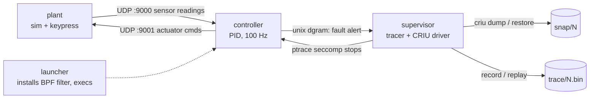

# Snapshot + record/replay for a PID control loop

Demo of a non-intrusive fault-reproduction setup for a running control loop:

- **CRIU** periodically snapshots the controller.
- **seccomp + ptrace** record the results of its nondeterministic syscalls.
- When the controller reports a fault, the supervisor suspends it, restores the newest snapshot and
  replays the recorded inputs with the plant switched off. The fault occurs again, proving it is
  determined by the recorded data.

The controller source contains no snapshot, tracing or replay code.

## Architecture



| Component | File | Role |
|---|---|---|
| controller | [src/controller.c](src/controller.c) | PID loop on a 10 ms timerfd tick. Reads sensor UDP datagrams, calls `clock_gettime` (raw syscall, so seccomp sees it), sends actuator UDP datagrams. On a non-finite reading it sends an alert on a unix datagram socket and sleeps. |
| launcher | [src/launcher.c](src/launcher.c) | Starts a new session, installs a raw-BPF seccomp filter (no libseccomp), stops itself so the supervisor can attach, then execs the controller. The filter survives `exec` and CRIU dump/restore. |
| supervisor | [src/supervisor.c](src/supervisor.c) | Spawns the controller, is its ptrace tracer, owns `trace/` and `snap/`, takes snapshots, listens for the alert, restores and replays. |
| plant | [src/plant.c](src/plant.c) | First-order plant simulation. Sends readings at 100 Hz, integrates actuator commands. Sends a NaN "poison" reading on key `f` or after `--fault-after S`. |
| shared | [src/common.h](src/common.h) | Ports, message structs, tick period (`TICK_NS`), list of traced syscalls. |

State lives under the workdir (default `run/`):

```
sup.sock            supervisor's alert socket
controller.log      controller stderr (shared by the original run and the replay)
trace/NNNNNN.bin    syscalls recorded after snapshot N (N=0: since launch)
snap/NNNNNN/        CRIU images of snapshot N (dump.log, restore.log inside)
original.log        controller output since the restored snapshot, original run
replay.log          controller output during the replay
```

## How it works

**Filtering.** The launcher's filter returns `SECCOMP_RET_TRACE` for `read`, `recvfrom`,
`clock_gettime`, `gettimeofday`, `time`, `getrandom` (nondeterministic results) and `sendto`
(payload is verified on replay). Everything else runs untouched. It also kills the process on a
foreign architecture or the x32 ABI. A traced syscall with no tracer fails with `ENOSYS`, so the
supervisor must always be attached when the controller runs.

**Recording.** At each seccomp stop the supervisor resumes the tracee with `PTRACE_SYSCALL`, reads the
return value at the syscall-exit stop, and appends a record: syscall number, six arguments, return
value, and the tracee memory the kernel wrote (the `read`/`recvfrom` buffer, the `timespec`, ...).
For `sendto` it records the payload sent. Results of `-ERESTARTSYS` and friends are skipped; the
kernel re-issues those syscalls and they are traced again.

**Snapshots.** CRIU must seize the process itself, which conflicts with an existing tracer. Each
period the supervisor therefore:

1. sends `SIGSTOP` and waits for the signal-delivery stop,
2. checks no fault alert is pending (otherwise the state is already past the fault),
3. detaches with `PTRACE_DETACH` passing `SIGSTOP`, so the process lands in a plain group-stop and
   never runs untraced,
4. runs `criu dump --leave-running`,
5. starts a new trace file, re-seizes the process and continues it.

The newest 3 snapshots are kept (`--keep`).

**Fault.** The plant sends a NaN reading; the controller detects it and sends an alert to
`sup.sock`. The supervisor stops the controller, stops the plant (`--plant-pid`, or you do it), and
checks that UDP port 9001 is free so no live input can reach the controller.

**Replay.** The supervisor kills the controller and runs `criu restore -d -s` (restored stopped, so
no traced syscall runs before it is attached), seizes it and feeds it the trace:

- for recorded-result syscalls the real syscall is skipped (`orig_rax = -1`) and the recorded return
  value and memory are injected, so no time passes and no data arrives from outside,
- for `sendto` the real syscall runs, but only after the payload is compared with the recorded one,
- any difference in syscall number, arguments or payload is reported as `DIVERGENCE`.

Reproduction is declared when the replayed controller sends the fault alert again. If the trace is
exhausted without an alert, the replay reports that the fault did not occur.

**No-CRIU mode.** With `--no-criu` there are no snapshots. Replay restarts the controller from scratch
and replays the whole trace. The launcher disables ASLR so that addresses match between runs.

## Prerequisites

- Linux x86_64 (the BPF filter is x86_64 only), kernel with `CONFIG_CHECKPOINT_RESTORE` and
  `CONFIG_SECCOMP_FILTER`, `ptrace` allowed (kernel 5.3+ for `PTRACE_GET_SYSCALL_INFO`).
- `gcc` and `make`.
- CRIU (tested with 3.16.1) and root privileges (only for CRIU mode).

```
sudo apt install build-essential criu
```

Notes:

- CRIU 3.16 with glibc 2.35+ crashes on restore (rseq). The supervisor sets
  `GLIBC_TUNABLES=glibc.pthread.rseq=0` for its `criu` calls as a workaround. CRIU 3.18 or later
  fixes this properly; use it via `--criu /path/to/criu`.
- Tested on WSL2 (kernel 5.15). Other setups may need extra CRIU options.

## Build

```
make          # binaries in build/
make clean    # also removes run/
```

## Run

One-shot demo (the plant injects the fault by itself after `FAULT_AFTER` seconds, default 7):

```
sudo ./demo.sh               # real CRIU snapshots
./demo.sh --no-criu          # no root, replay restarts from scratch
FAULT_AFTER=12 sudo ./demo.sh
RUN=/tmp/work sudo ./demo.sh # different workdir
```

Run `sudo rm -rf run` first if an earlier `sudo` run left a root-owned `run/`.

Manual run in two terminals, with the fault triggered by a keypress:

```
# terminal 1
sudo ./build/supervisor --workdir run --interval 1000
# terminal 2
./build/plant            # keys: f = poison reading, + / - = setpoint, q = quit
```

Press `f` in the plant terminal. The supervisor then asks you to stop the plant (`q`) and press
Enter to restore and replay. Add `--plant-pid PID --auto-replay` to skip both prompts.

Supervisor options:

| Option | Default | Meaning |
|---|---|---|
| `--workdir DIR` | `run` | state directory |
| `--launcher PATH`, `--controller PATH` | `build/...` | binaries to run |
| `--interval MS` | 2000 | snapshot period (the demo script uses 2000) |
| `--keep N` | 3 | snapshots to keep |
| `--criu PATH` | `criu` | CRIU binary |
| `--no-criu` | off | no snapshots, replay from scratch |
| `--plant-pid PID` | none | SIGTERM this plant on fault |
| `--auto-replay` | off | do not wait for Enter before restoring |
| `-v` | off | log every recorded and replayed syscall |

Exit code: `0` fault reproduced, `1` not reproduced or an error, `2` replay diverged, `130`
interrupted.

The sampling rate is `TICK_NS` in [src/common.h](src/common.h) (10 ms by default).

## Expected output

Captured from `sudo ./demo.sh` (CRIU on, snapshot every 2 s, fault after 7 s) on WSL2. Numbers vary
from run to run.

```
[sup] controller pid 247016 recording (criu on, snapshot every 2000 ms)
[sup] snapshot 1: controller frozen 87.3 ms (detach 0.1 + criu dump 87.0 + reattach 0.2), 1198 syscalls recorded since previous
[sup] snapshot 2: controller frozen 10.9 ms (detach 0.1 + criu dump 10.7 + reattach 0.2), 1157 syscalls recorded since previous
[sup] snapshot 3: controller frozen 11.1 ms (detach 0.1 + criu dump 10.9 + reattach 0.2), 1196 syscalls recorded since previous
[sup] FAULT reported by controller: seq=790 non-finite measurement
[sup] controller (pid 247016) suspended; last snapshot=3, 1141 syscalls recorded since

=== timing report (record phase, control tick = 10.0 ms) ===
tracing: 3910 traced syscalls (excl. blocking read); tracee stalled per syscall avg 144 us, max 476 us (recording part avg 42 us)
control loop (controller's own clock, 6 x 100 ticks): wake-up latency avg 552 us, max 91034 us; per-tick work avg 988 us, max 2230 us
snapshots: 3; controller frozen avg 36.4 ms, max 87.3 ms (criu dump avg 36.2 ms, max 87.0 ms); 3 of 3 froze it longer than one tick
late ticks (wake-up > 5 ms or timer ticks missed): 4, 9 ticks missed in total; 4 coincide with a snapshot freeze, 0 do not

[sup] stopping plant (pid 247014)
[sup] waiting for plant to exit...
[sup] plant is down: no external input can reach the controller from now on
[sup] restoring snapshot 3 with CRIU
[sup] replaying trace-000003: 1141 recorded syscalls
[sup] FAULT REPRODUCED during replay after 1141/1141 syscalls: seq=790 non-finite measurement

=== controller output, original run (from snapshot 3) ===
[late] seq=591 t=23763.986191 wake_us=11706 missed=0
[stat] seq=600 n=100 wake_avg=500 wake_max=11706 proc_avg=993 proc_max=1358 missed=0
[ctrl] seq=609 y=0.9647 sp=1.00 u=0.9710
[ctrl] seq=659 y=0.9705 sp=1.00 u=0.9757
[stat] seq=700 n=100 wake_avg=392 wake_max=959 proc_avg=1006 proc_max=1467 missed=0
[ctrl] seq=709 y=0.9753 sp=1.00 u=0.9797
[ctrl] seq=759 y=0.9793 sp=1.00 u=0.9830
[ctrl] FAULT: seq=790 non-finite measurement
=== controller output, replayed from trace (plant down) ===
(the same eight lines)
=== printed logs IDENTICAL (saved as original.log / replay.log) ===
=== 190 sendto payloads (actuator commands, fault alert) matched the recording byte for byte ===

[sup] result: fault is deterministic given the recorded inputs
```

The script then prints the tails of `plant.log` and `controller.log` and
`supervisor exit code: 0 (0 = fault reproduced from the trace)`.

With `--no-criu` the snapshot lines are absent and the replay line reads "no snapshot yet:
restarting controller from scratch". What to check:

- snapshots appear about once per interval until the fault,
- the controller is suspended on the alert and the plant is stopped before the restore,
- the replayed controller prints the same values and the same `FAULT` line as the original. The
  `[stat]` and `[late]` timing lines are identical too, because the replay serves the recorded
  clock readings, so they show the original run's timing, not the replay's,
- all `sendto` payloads match and the supervisor exits with 0.

## Timing and overhead

Both costs are measured, so you can judge whether they fit your control period.

**What is measured**

- *Tracing cost:* per traced syscall, the supervisor measures how long the tracee is stalled between
  the seccomp stop and the release after the exit stop (blocking `read` is excluded, it only waits
  for the tick).
- *Control loop timing:* the controller measures, with its own clock, the **wake-up latency** (timer
  expiry to code running, against an absolute tick-aligned schedule), the **per-tick work time** and
  the **missed ticks** (`expirations > 1` on the timerfd). It prints a `[stat]` line every 100 ticks
  and a `[late]` line for every tick that wakes up more than 5 ms late or misses a tick.
- *Snapshots:* for each snapshot the supervisor prints how long the controller was frozen, split into
  detach, `criu dump` and reattach.

The supervisor combines these into the timing report shown above when the fault arrives (or on
Ctrl+C).

**Measured results.** `bench.sh` runs the same plant and controller in three setups for `SECS`
seconds (default 20) and prints a table of wake-up latency, work time, missed and late ticks. A:
untraced. B: traced, no snapshots. C: traced with a snapshot per second (root only). Result on WSL2
(20 s each):

```
scenario                       wake avg   wake max   work avg   work max   missed   late
                                   (us)       (us)       (us)       (us)    ticks  ticks
A untraced                          206       1373         48       1063        0      0
B traced                            356       1249        945       3479        0      0
C traced + snapshot/1s              664      17421       1017       4472        3     27

tracing: 9747 traced syscalls (excl. blocking read); tracee stalled per syscall avg 148 us, max 3339 us (recording part avg 43 us)
snapshots: 19; controller frozen avg 18.2 ms, max 133.5 ms (criu dump avg 17.9 ms, max 133.1 ms); 19 of 19 froze it longer than one tick
late ticks (wake-up > 5 ms or timer ticks missed): 27, 16 ticks missed in total; 27 coincide with a snapshot freeze, 0 do not
```

**How to read it**

- *Tracing is acceptable here.* Per-tick work rises from about 50 us to about 1 ms (about 20x), but
  that is roughly 10% of the 10 ms tick and the worst case (3.5 ms) still fits. B shows no missed
  or late ticks, and wake-up latency stays around 0.4 ms. Each traced syscall stalls the controller
  for about 150 us, mostly kernel stop/resume and scheduling; recording itself is about 40 us. With
  about 5 traced syscalls per tick, cost scales with the number of traced syscalls per tick, so keep
  the filter list short. Watch *work max* against the tick: when it approaches the tick, the loop
  starts missing deadlines.
- *Snapshots do disturb the loop.* Every snapshot froze the controller for longer than one tick
  (19 of 19 in C), and the only late ticks in C (27) all coincide with a freeze; none are caused by
  tracing or scheduler noise. Typical freezes are about 11 ms, which costs roughly one late tick.
  The first snapshot is slower (87 ms in the demo) and occasional ones are much slower (133 ms in
  C), which costs several ticks. The plant's datagrams queue in the UDP socket meanwhile, and the
  controller checks every queued reading when it resumes, so no readings are lost. So the
  snapshot cost does not fit inside one 10 ms tick, but it is bounded, visible in the report, and
  limited to the snapshot moments.
- *Making snapshots cheaper:* snapshot less often, dump less memory (a small process dumps faster),
  or use CRIU's incremental dumps (`--track-mem`, not implemented here). Almost all of the freeze is
  the `criu dump` itself; the detach and reattach steps take about 0.1 and 0.2 ms.
- *Late ticks outside snapshots* would point at tracing load or scheduler noise; the table above
  has none.

## Limitations

- x86_64 only, single-threaded tracee.
- Emulated `read` calls do not advance file offsets. This is fine for the timerfd and sockets
  used here.
- Syscalls that restart internally (`poll`, `nanosleep`, `futex`) are not filtered and would need
  extra handling.
- Only syscalls in the traced list are recorded. Another source of nondeterminism (for example a
  signal, a thread race or a `recvmsg`) breaks replay and shows up as `DIVERGENCE`.
- After `criu restore -s` there is a short window before the supervisor attaches. A traced syscall
  in that window would fail with `ENOSYS`.
